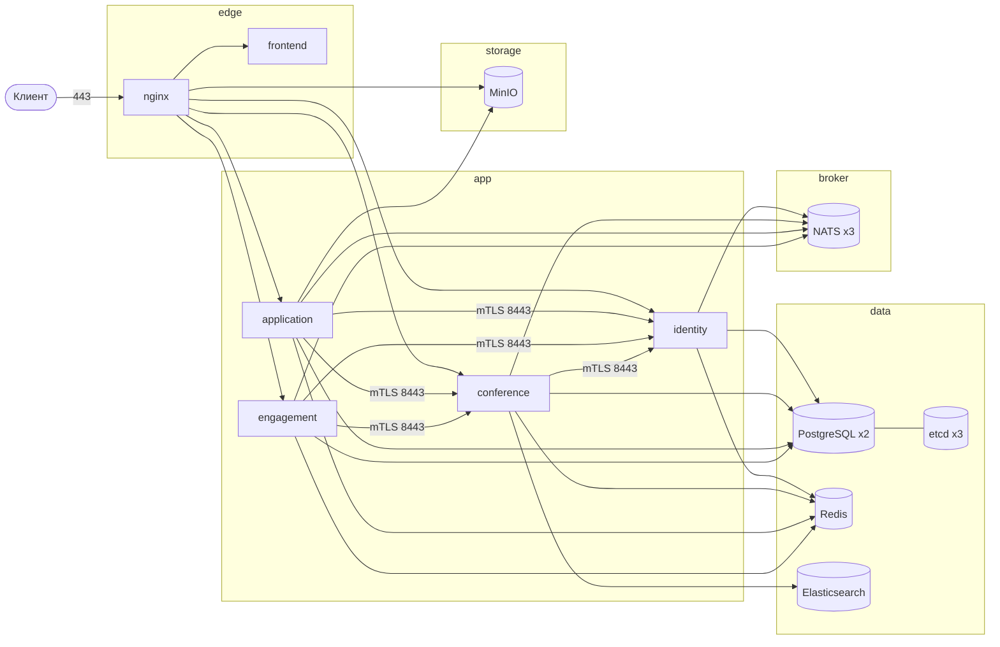

# Сегментация сети и межсетевой экран

Контейнеры ConfHub разнесены по пяти сегментам. Между сегментами трафик не
ходит вообще, внутри сегмента разрешены только соединения, перечисленные в
[`back/firewall/policy.conf`](../back/firewall/policy.conf). Всё остальное
отбрасывается.

## Сегменты

Подсети показаны для рабочего проекта (`CONFHUB_NET_PREFIX=172.28`). Тестовый
стенд `confhub-lab` использует `172.29` и мосты `chl-*`.

| Сегмент | Подсеть | Мост | Выход наружу | Кто подключён |
| --- | --- | --- | --- | --- |
| `edge` | 172.28.10.0/24 | `chb-edge` | только ответы клиентам | nginx, frontend |
| `app` | 172.28.20.0/24 | `chb-app` | по списку `egress` | nginx, 4 сервиса, django-admin, jaeger, mailpit, Prometheus |
| `data` | 172.28.30.0/24 | `chb-data` | нет (`internal`) | 4 сервиса, django-admin, PostgreSQL, etcd, Redis, Elasticsearch |
| `broker` | 172.28.40.0/24 | `chb-broker` | нет (`internal`) | 4 сервиса, узлы NATS |
| `storage` | 172.28.50.0/24 | `chb-storage` | нет (`internal`) | nginx, application-svc, MinIO |

Адреса контейнеров статические и заданы в `docker-compose.prod.yml`: последний
октет одинаков во всех сегментах сервиса (identity-svc — `.21`, conference-svc —
`.22`, application-svc — `.23`, engagement-svc — `.24`).



Что даёт деление:

* frontend и nginx не имеют интерфейса в `data` и `broker`: взлом входного
  контура не даёт сетевого доступа к базе и брокеру;
* базы и брокер не имеют маршрута в интернет: утечка данных напрямую с них
  невозможна;
* наружу ходят только identity-svc и application-svc (HTTPS: ORCID, проверка
  утёкших паролей) и engagement-svc (SMTP).

## Как работает фильтрация

Сегмент — это отдельный Linux-мост. Пакеты между контейнерами одного моста
коммутируются на втором уровне и в `iptables` не попадают, поэтому правила
`DOCKER-USER` на них не действуют. Фильтрация выполняется nftables в двух
таблицах, которые создаёт [`back/scripts/firewall.sh`](../back/scripts/firewall.sh):

| Таблица | Что фильтрует | Политика |
| --- | --- | --- |
| `bridge confhub_fw` | соединения между контейнерами внутри сегментов | default deny, разрешения из `allow` |
| `ip confhub_fw` | выход из сегментов во внешние сети | default deny, разрешения из `egress` |

Правила привязаны к паре адресов и порту назначения. Ответные пакеты проходят
по состоянию соединения (`ct state established`). Отброшенные пакеты считаются
счётчиком и пишутся в журнал ядра с префиксом `confhub-fw drop:`.

Таблицы свои, с именем проекта. Правила Docker, `ufw` и других проектов на
хосте скрипт не меняет.

## Команды

```bash
cd back
sudo ./scripts/firewall.sh apply      # применить policy.conf
sudo ./scripts/firewall.sh show       # все действующие правила и счётчики (вывод nft)
sudo ./scripts/firewall.sh rules      # те же правила по строке на правило
sudo ./scripts/firewall.sh test       # проверить каждое разрешённое и запрещённое соединение
sudo ./scripts/firewall.sh revoke conference-svc postgres   # снять правило
sudo ./scripts/firewall.sh restore    # вернуть полную политику
sudo ./scripts/firewall.sh down       # удалить таблицы
```

Для тестового стенда перед командой указывается `COMPOSE_PROJECT=confhub-lab`.

`deploy.sh` применяет политику после запуска контейнеров и включает
`confhub-firewall.service`, который восстанавливает её после перезагрузки.

## Демонстрация

1. **Все правила.** `firewall.sh show` печатает обе таблицы: каждое разрешение с
   комментарием `сегмент: источник -> получатель` и итоговое `default deny`.
2. **Разрешённое проходит, запрещённое нет.** `firewall.sh test` открывает
   TCP-соединение из сетевого пространства каждого контейнера: сначала по всем
   правилам политики (ожидается `open`), затем с каждого соседа по сегменту, у
   которого правила нет (ожидается `blocked`). На стенде `confhub-lab` это 230
   проверок, на рабочем — 283 (с консолью администратора и Prometheus).
   `firewall.sh test --summary` печатает итог по сегментам, `firewall.sh rules` —
   все действующие правила по строке на правило.
3. **Отказ при снятии нужного правила.**

   ```bash
   sudo ./scripts/firewall.sh revoke conference-svc postgres
   sudo ./scripts/firewall.sh revoke conference-svc postgres-2
   curl -i http://127.0.0.1:18081/api/v1/conferences      # 504 Gateway Time-out
   docker exec confhub-lab-conference-svc-1 wget -qO- http://127.0.0.1:8082/readyz   # 503
   curl -i http://127.0.0.1:18081/api/v1/auth/me          # 401: identity-svc работает
   sudo ./scripts/firewall.sh restore
   curl -i http://127.0.0.1:18081/api/v1/conferences      # 200
   ```

   Снятое правило заменяется явным запретом, поэтому рвутся и уже открытые
   соединения из пула сервиса.

## Изменение политики

Новое соединение добавляется строкой `allow` в `policy.conf` и командой
`firewall.sh apply`. Набор правил заменяется атомарно: если в файле ошибка,
действующие правила остаются без изменений.

## Ограничения

* etcd и NATS работают без TLS и аутентификации; доступ к ним ограничен только
  сегментом и правилами экрана.
* Правила ссылаются на адреса контейнеров. Контейнер, запущенный вручную в
  сегменте, не получит доступа, пока не добавлен в политику.
* Команды `docker exec` и сокет Docker на хосте экран не ограничивает.
